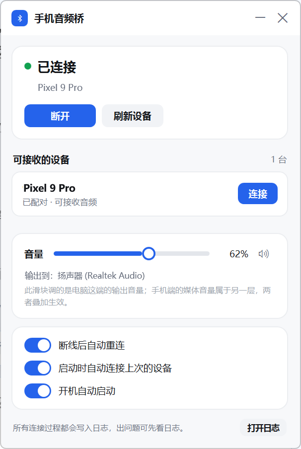

# 手机音频桥 · PhoneAudioBridge

把手机的蓝牙音频接到 Windows 电脑上播放，让电脑充当蓝牙音频接收端（A2DP Sink）。

带连接失败诊断、音频端点音量控制、断线自动恢复，以及"已连接但没有声音"的实时判断。

> 本项目是独立开发的第三方工具，与 Microsoft、Bluetooth SIG 及任何应用商店中的同类应用均无关联。详见 [NOTICE.md](NOTICE.md)。

[English](README.en.md) · [更新日志](CHANGELOG.md) · [声明与许可](NOTICE.md)



---

## 为什么会有这个项目

从 Windows 10 版本 2004（内部版本 19041）起，系统提供了一套公开接口 `Windows.Media.Audio.AudioPlaybackConnection`，可以让电脑把已配对手机的声音接收过来播放。但微软没有提供对应的桌面界面应用。

应用商店中存在实现同一功能的商业应用，其音量行为有公开记录的问题：音量被固定在最大值无法调节、以及音量控制在听音乐过程中失灵且必须断开重连才能恢复（见文末引用）。这类应用不提供源码，无法在其基础上修补。

本项目用**同一套系统接口**重新实现，目标很具体：把失败原因讲清楚、把音量做对、断线后能自己回来。

## 功能

**连接失败时给出具体原因**
系统接口的 `Open()` 返回结果对象里带状态码，可区分**成功 / 手机超时未响应 / 被系统拒绝 / 未知失败**四种情况。程序把它们翻译成可操作的中文提示，例如"手机未在限时内响应，请在手机上重新播放一次"，而不是笼统地报"连接失败"。

**断线自动恢复，且不会失控**
非用户主动断开时，按 1.5 → 3 → 6 → 12 → 24 → 30 秒退避重试 6 次；仍未恢复则转为每 30 秒低频探测一次，最长约 20 分钟。低频段是为通话场景准备的：通话期间链路被免提模式占用，通话结束后通常会自动恢复，程序应当等它回来。

**音量直接操作音频端点**
滑块作用于当前默认播放设备的音频端点音量（`IAudioEndpointVolume`），不经过系统音量面板。拖动即时生效、数值不跳变；设置音量时若处于静音会自动解除静音。

**记住音量**
断开与退出时记录当前音量，下次连接成功后自动还原。

**设备列表不会卡死**
每次连接前重新枚举设备并重新绑定音量端点。切换耳机或重新配对之后不需要重启程序。

**能分辨"连上了但没声音"**
每 2 秒读取输出设备的实时峰值电平。若本次连接中确实出现过声音、之后连续 60 秒无音频流，面板会显示提示条（见下方第二张截图）。这类故障在状态栏上仍显示"已连接"，是最难排查的一种。

另外还包括：托盘常驻、图标颜色反映连接状态（灰/橙/绿/红）、双击托盘还原面板、开机自启、单实例运行、全流程日志。

## 系统要求

- Windows 10 版本 2004（内部版本 19041）或更高。Windows 11 已测试。
- 手机需先与电脑完成蓝牙配对，未配对的设备不会出现在列表中。
- 免安装发布版**不需要**安装 .NET 运行时。

## 安装与使用

1. 从 [Releases](../../releases) 下载 `PhoneAudioBridge.exe`。
2. 双击运行。程序没有代码签名，Windows SmartScreen 可能提示"未知发布者"，选择"更多信息 → 仍要运行"。
3. 在手机与电脑之间完成一次蓝牙配对（`设置 → 蓝牙和其他设备 → 添加设备`）。
4. 面板中会出现已配对的手机，点"连接"。
5. 在手机上播放音频，声音即从电脑当前默认播放设备输出。
6. 点窗口右上角 ✕ **只是收进托盘**；要真正退出，请右键托盘图标选择"退出"。

出问题时点面板上的"打开日志"，日志位于 `%LOCALAPPDATA%\PhoneAudioBridge\logs\`。

## 已知限制

以下多为系统接口与蓝牙协议本身的边界，不是程序缺陷。

- **通话音频无法转发。** 语音/视频通话需要麦克风，会切换到免提（HFP）模式；此时系统会丢弃送往立体声（A2DP）的音频流，且 Windows 的蓝牙驱动不提供手机→电脑方向的 HFP 客户端角色。任何同类软件都受此限制。详见下方「通话时为什么没有声音」。
- **音量分两层。** 手机端媒体音量决定编码发送前的大小，电脑端输出音量决定最终播放大小，两者叠加。滑块只管第二层。
- **存在可感知延迟。** 蓝牙链路本身有延迟，观看视频会轻微音画不同步。
- **音质受编码限制。** Windows 内置的 A2DP Sink 使用 SBC 编码，音质与音量上限均属一般水平。
- **未做代码签名。** 因此无法避免 SmartScreen 提示，也无法提供自动更新。

## 常见问题

**列表里没有我的手机**
先在系统设置里完成配对。程序只枚举已配对且具备音频接收能力的设备，不能代为配对。

**显示已连接，但没有声音**
先确认手机正在播放。若面板出现"已连接但未收到音频流"提示条，常见原因是：手机把输出切到了扬声器、手机上正在通话、或音量被调到 0。日志会记录每次端点音量变化，可据此判断音量命令是否到达电脑。

**调手机音量，电脑这边不变**
说明手机没有下发蓝牙绝对音量命令。多数安卓机在开发者选项中提供"停用绝对音量"开关，关闭它（即允许绝对音量）后手机才会把音量命令发给电脑。注意绝对音量是双向的：开启后手机也会改动电脑音量。

**关掉窗口后程序还在运行**
这是设计行为，程序常驻托盘。右键托盘图标选"退出"才会真正结束。

## 通话时为什么没有声音

这是协议限制，不是可以修复的缺陷。

1. 微软文档明确说明：音频进入免提（HFP）模式后，系统会丢弃任何送往立体声输出（A2DP）的音频流。A2DP 是单向高质量媒体通道，不含麦克风；手机一旦需要采集麦克风，链路即切换到 HFP，A2DP 通道失效。
2. Intel 官方在支持论坛答复同一问题：Windows 的蓝牙驱动只提供 HFP 的"网关"角色（电脑连接耳机打电话），不提供手机→电脑方向所需的客户端角色。

因此通话期间的声音无法经蓝牙转到电脑。程序能做的是：通话结束后自动把音频流接回来，以及在长时间收不到音频时明确告知原因。

若必须在通话时把手机声音转到电脑，只能离开蓝牙链路，改用基于 Wi-Fi 的音频转发工具，或直接在电脑上登录通话应用。

## 从源码构建

需要 [.NET 8 SDK](https://dotnet.microsoft.com/download/dotnet/8.0)。

```bash
git clone <本仓库地址>
cd PhoneAudioBridge

# 调试构建
dotnet build src/PhoneAudioBridge/PhoneAudioBridge.csproj -c Release

# 免安装单文件发布
dotnet publish src/PhoneAudioBridge/PhoneAudioBridge.csproj -c Release -r win-x64 \
  --self-contained true -p:PublishSingleFile=true \
  -p:EnableCompressionInSingleFile=true \
  -p:IncludeNativeLibrariesForSelfExtract=true \
  -p:DebugType=none -o publish
```

产物为 `publish/PhoneAudioBridge.exe`，约 70 MB（内含 .NET 运行时）。

仓库中的 GitHub Actions 工作流会在每次推送时执行同样的构建。

## 项目结构

```
PhoneAudioBridge/
├─ src/PhoneAudioBridge/
│  ├─ App.xaml(.cs)                 应用入口、单实例、生命周期
│  ├─ MainWindow.xaml(.cs)          主面板与交互
│  ├─ TrayIconHost.cs               托盘图标（运行时绘制，无外部资源）
│  ├─ Win11Visuals.cs               Windows 11 DWM 圆角
│  ├─ Services/
│  │  ├─ BluetoothAudioService.cs   连接状态机、错误诊断、自动重连
│  │  ├─ VolumeService.cs           音频端点音量
│  │  ├─ AppSettings.cs             配置持久化
│  │  ├─ AutoStart.cs               开机自启（HKCU Run）
│  │  └─ Log.cs                     日志
│  └─ app.manifest                  DPI 感知与系统兼容声明
├─ docs/                            截图
├─ LICENSE
├─ NOTICE.md                        声明与第三方许可
└─ CHANGELOG.md
```

技术栈：.NET 8 + WPF；蓝牙部分走 WinRT `Windows.Media.Audio.AudioPlaybackConnection`（经 CsWinRT 投影，非打包桌面应用可直接调用）；音量部分使用 NAudio 的 `MMDeviceEnumerator`。

配置与日志位置：`%LOCALAPPDATA%\PhoneAudioBridge\`

## 隐私

- 程序**不发起任何网络请求**，不含遥测、统计或自动更新，不需要账号。
- 配置与日志仅保存在本机 `%LOCALAPPDATA%\PhoneAudioBridge\`。
- 日志会记录设备名称与音量数值，如需提交 Issue，请先确认其中没有你不愿公开的信息。

## 相关项目

同样基于 `AudioPlaybackConnection` 的开源实现，列出仅为便于比较，与本项目无隶属关系：

| 项目 | 语言 | 说明 |
|---|---|---|
| [ysc3839/AudioPlaybackConnector](https://github.com/ysc3839/AudioPlaybackConnector) | C++ | 该方向上最早也最成熟的开源实现 |
| [DylanUncle/Audio_Bridge](https://github.com/DylanUncle/Audio_Bridge) | C++ | 侧重自动重连 |
| [AkiroMusic/AkiLink](https://github.com/AkiroMusic/AkiLink) | C# WPF | 深色界面 |
| [blameTheCache/soundbridge](https://github.com/blameTheCache/soundbridge) | C# | 桌面应用 |
| [tiwut/Bluetooth-Audio-Receiver](https://github.com/tiwut/Bluetooth-Audio-Receiver) | C# | 桌面应用 |
| [byzp/bluetooth_audio_cli](https://github.com/byzp/bluetooth_audio_cli) | C++ | 命令行 |

## 许可证

代码以 [MIT 许可](LICENSE) 发布。所依赖的开源组件（.NET、CsWinRT、NAudio）均为 MIT 许可，具体列于 [NOTICE.md](NOTICE.md)。

## 引用

“AudioPlaybackConnection Class.” *Microsoft Learn*, Microsoft, learn.microsoft.com/en-us/uwp/api/windows.media.audio.audioplaybackconnection.

“AudioPlaybackConnectionOpenResultStatus Enum.” *Microsoft Learn*, Microsoft, learn.microsoft.com/en-us/uwp/api/windows.media.audio.audioplaybackconnectionopenresultstatus.

“Bluetooth Classic Audio.” *Microsoft Learn*, Microsoft, learn.microsoft.com/en-us/windows-hardware/drivers/bluetooth/bluetooth-classic-audio.

“Re: Cannot Use PC as Bluetooth Headset for Smartphone. Win 10.” *Intel Community*, Intel Corporation, community.intel.com/t5/Wireless/Cannot-use-PC-as-Bluetooth-headset-for-smartphone-Win-10/m-p/525280.

“The ‘Bluetooth Audio Receiver’ App Is at a Fixed Volume.” *Microsoft Q&A*, Microsoft, 6 July 2025, learn.microsoft.com/en-us/answers/a/8211308.
